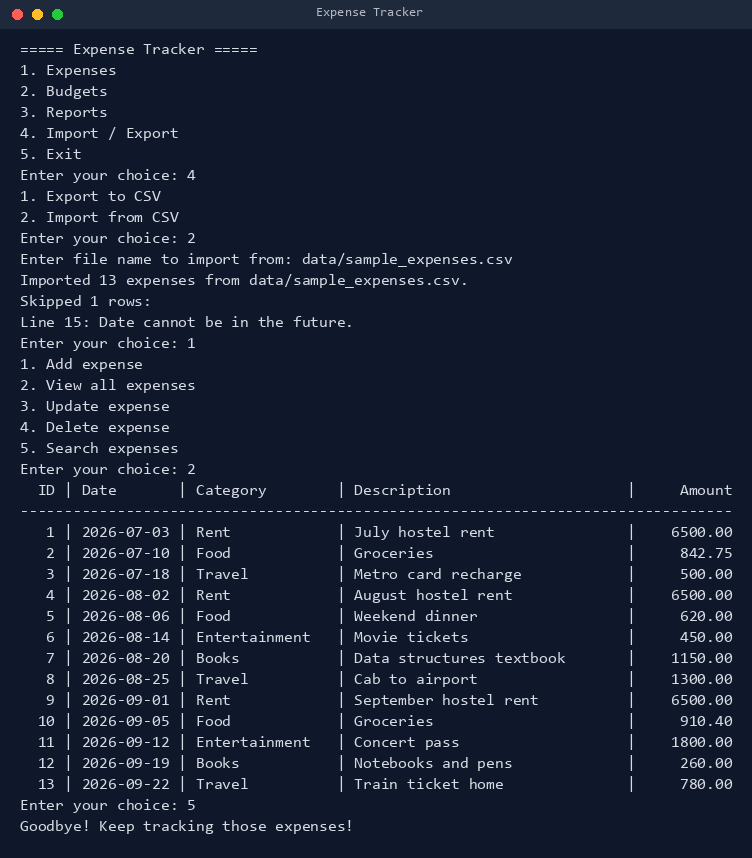
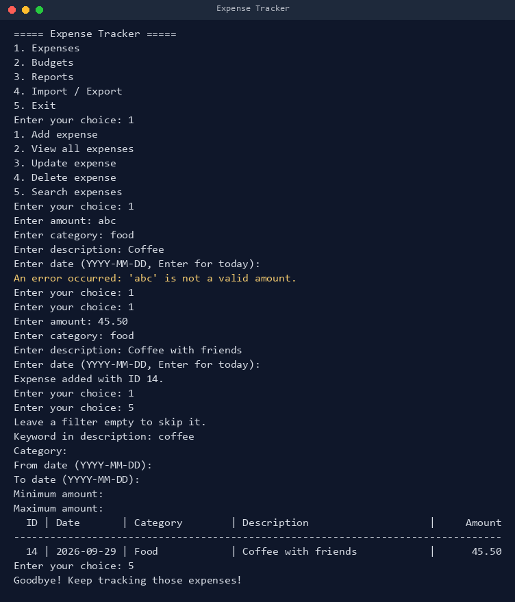
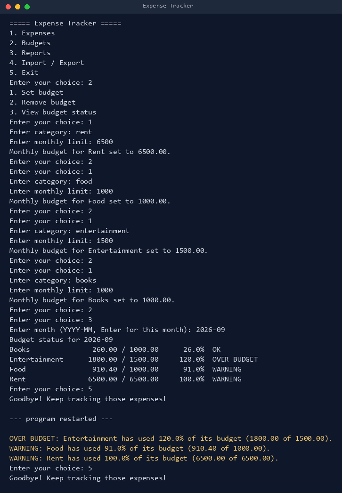
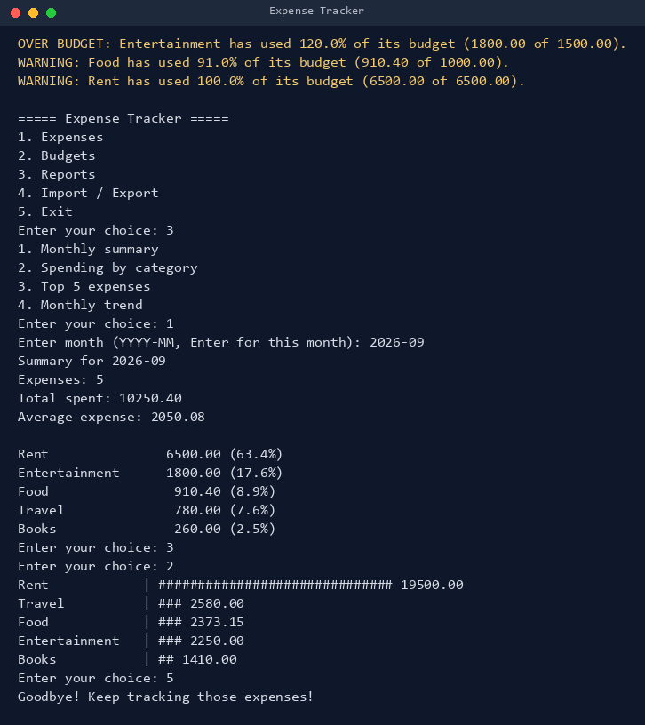

# Pocket Ledger: Personal Expense Tracker

A command-line expense tracker written in Python. It lets a student or young professional record daily spending, set monthly budgets per category, get warnings before overspending, and see where the money went through summaries and text charts. All data is kept in a single local JSON file, so nothing needs to be installed and nothing leaves the computer.

## Overview

Most people know roughly what they earn but not where it goes. Pocket Ledger keeps a simple, honest record of every expense, compares it with the limits you set, and reports the result at the start of each session and on demand.

## Features

| Module | What it does |
| --- | --- |
| Expense management | Add, view, update, delete and search expenses (keyword, category, date range, amount range) |
| Budgets and alerts | Set a monthly limit per category, see `OK` / `WARNING` (80% or more) / `OVER BUDGET` status, and get alerts automatically on start-up |
| Reports and analytics | Monthly summary with category share, category bar chart, top 5 expenses, month-by-month trend |
| Import / export | Export to CSV, import from CSV with row-by-row error reporting |

Also included: money stored as exact `Decimal` values, strict input validation, atomic file saves, recovery from a corrupted data file, an activity log, and CSV formula-injection protection.

## Technologies

- Python 3.10 or newer (uses `match`/`case`)
- Standard library only: `json`, `csv`, `decimal`, `datetime`, `logging`, `unittest`
- Optional, only for regenerating the diagrams, screenshots and PDF report: `matplotlib`, `Pillow`, `reportlab`

## Project structure

```
Expense_Tracker/
├── Main.py                  entry point
├── tracker/
│   ├── Menu.py              menus, input and output
│   ├── Expense_Manager.py   create / read / update / delete / search
│   ├── Budget_Manager.py    budgets, status and alerts
│   ├── Reports.py           summaries and text charts
│   ├── Csv_Transfer.py      CSV import and export
│   ├── Expense_Model.py     Expense class
│   ├── Storage.py           JSON storage with atomic saves
│   ├── Validators.py        all input checks
│   └── Logger.py            activity log
├── tests/                   unit tests (unittest)
├── data/sample_expenses.csv sample data to try the import
├── docs/                    diagrams, screenshots, PDF report and the scripts that build them
├── README.md
├── statement.md
└── requirements.txt
```

## Install and run

```
git clone <your repository url>
cd Expense_Tracker
python Main.py
```

No packages need to be installed to run the application. The data file `data/expenses.json` and the log `logs/expense_tracker.log` are created on first use.

To try it with sample data: choose `4. Import / Export`, then `2. Import from CSV`, and enter `data/sample_expenses.csv`. One row in that file is deliberately in the future so you can see how bad rows are skipped and reported.

## Testing

```
python -m unittest discover -s tests -t .
```

28 tests cover validation, CRUD, search, persistence across restarts, corrupted-file recovery, budgets, reports and CSV import/export.

## Screenshots

| Import with a skipped row | Add (with an error) and search |
| --- | --- |
|  |  |

| Budgets and start-up alerts | Reports |
| --- | --- |
|  |  |

## Design documents

Architecture, use case, workflow, sequence, class and ER diagrams are in `docs/images/` and explained in `docs/Expense_Tracker_Report.pdf`. Regenerate them with:

```
pip install matplotlib pillow reportlab
python docs/tools/make_diagrams.py
python docs/tools/make_screenshots.py
python docs/tools/make_report.py
```
